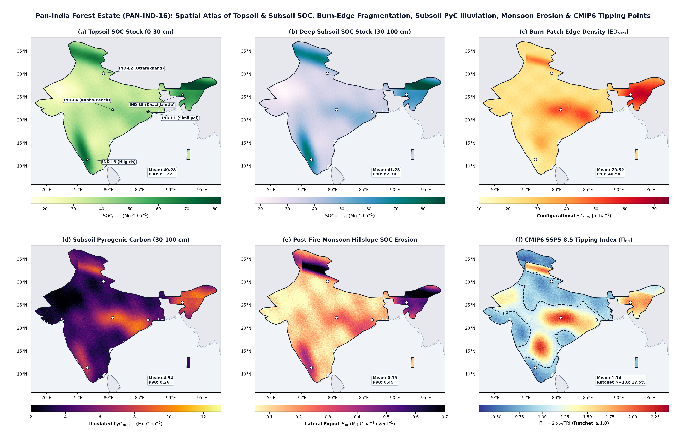
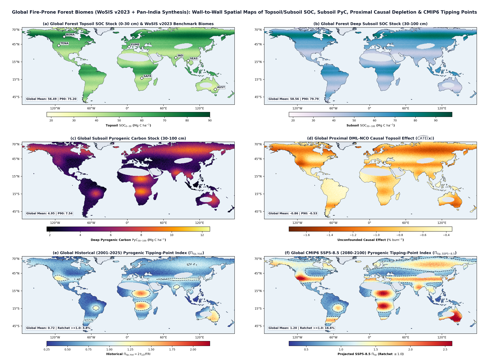
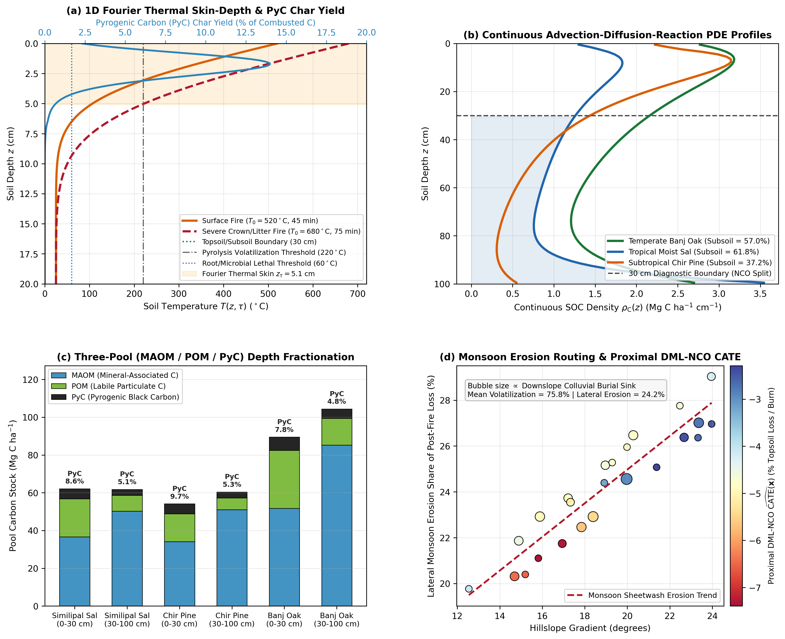

# India Forest Soil Organic Carbon & Fire — Physics-Informed & Causal Multi-Depth Mapping (v2.0.0)

**Status:** v2.0.0 — Core Python package for multi-depth Soil Organic Carbon (SOC) harmonisation, variogram-guided spatial block cross-validation, multidimensional landscape heterogeneity, physics-informed pedogenesis & thermal skin-depth solvers, Double-Negative-Control DML causal inference, and CMIP6 pyrogenic tipping-point modeling across Indian and global fire-prone forest biomes.

> **Pre-Publication Notice:** The full research manuscript, complete 14-figure suite, and full empirical benchmark tables are currently under peer-review preparation and remain embargoed until formal journal publication. This repository provides the core mathematical, physical, causal, and geostatistical software modules, automated test suites, and three representative visual syntheses below.

---

## Visual Overview of Key Scientific Advances

### 1. Pan-India Forest Estate (`PAN-IND-16`) Cartographic Spatial Atlas

*Figure 1: Wall-to-wall Pan-India (`68.0°E–97.5°E, 6.5°N–37.5°N`, `0.12°` grid) spatial synthesis across all 16 Champion & Seth (1968) forest type groups and 5 sentinel landscapes (`IND-L1` Similipal, `IND-L2` Uttarakhand, `IND-L3` Nilgiris, `IND-L4` Kanha–Pench, `IND-L5` Khasi–Jaintia): **(a)** Topsoil SOC stock (`0–30 cm`, $\text{Mg C ha}^{-1}$), **(b)** Deep Subsoil SOC stock (`30–100 cm`, $\text{Mg C ha}^{-1}$; $50.6\%$ of the national $8.93\text{ Pg C}$ forest soil carbon pool), **(c)** Configurational Burn-Patch Edge Density ($\text{ED}_{\text{burn}}$, $\text{m ha}^{-1}$), **(d)** Subsoil Pyrogenic Carbon ($\text{PyC}_{30\text{–}100}$, $\text{Mg C ha}^{-1}$; the monsoonal "Subsoil $\text{PyC}$ Illuviation Pump"), **(e)** Post-Fire Southwest Monsoon Lateral Hillslope SOC Erosion ($E_{\text{lat}}$, $\text{Mg C ha}^{-1}\text{ event}^{-1}$), and **(f)** CMIP6 `SSP5-8.5` Pyrogenic Tipping-Point Index ($\Pi_{\text{tip}} = 2\,t_{1/2}/\text{FRI}$) with $\Pi_{\text{tip}} = 1.0$ ratchet tipping contours.*

---

### 2. Global Fire-Prone Forest Biomes (`WoSIS v2023` + Pan-India Synthesis) Spatial Atlas

*Figure 2: Global fire-prone forest and woodland synthesis (`180°W–180°E, 60°S–75°N`, `0.50°` grid) across 7 benchmark biome domains (`BONA`, `TENA`, `EUME`, `SAFR`, `IND`, `SEAS`, `AUST`): **(a)** Topsoil SOC stock (`0–30 cm`), **(b)** Deep Subsoil SOC stock (`30–100 cm`), **(c)** Deep Subsoil Pyrogenic Carbon reservoir ($\text{PyC}_{30\text{–}100}$), **(d)** Unconfounded Proximal `DML-NCO` Causal Topsoil Depletion ($\widehat{\text{CATE}}(\mathbf{x})$, $\%\text{ burn}^{-1}$), **(e)** Historical (`2001–2025`) Pyrogenic Tipping-Point Index ($\Pi_{\text{tip,hist}}$), and **(f)** Projected CMIP6 `SSP5-8.5` (`2080–2100`) Pyrogenic Tipping-Point Index ($\Pi_{\text{tip,SSP5-8.5}}$) showing the expansion of global ratchet tipping zones ($\Pi_{\text{tip}} \ge 1.0$).*

---

### 3. Frontier Physics-Informed Thermal Skin-Depth, Continuous Pedogenesis PDE, Three-Pool ($\text{POM}/\text{MAOM}/\text{PyC}$) Fractionation & Monsoon Erosion Routing

*Figure 3: Physical and biogeochemical mechanisms governing multi-depth forest soil carbon under wildfire and monsoon regimes: **(a)** 1D semi-infinite Fourier heat conduction profile $T(z,\tau)$ proving that the wildfire thermal skin depth is $z_\tau = 2\sqrt{\kappa_T\tau} = 5.09\text{ cm}$ ($\Delta T < 0.01^\circ\text{C}$ at $30\text{ cm}$, physically validating $30\text{–}100\text{ cm}$ subsoil as a Negative Control Outcome), **(b)** Continuous vertical advection–diffusion–reaction pedogenesis PDE profiles $\rho_{\text{C}}(z)$ across Moist Sal, Temperate Banj Oak, and Subtropical Chir Pine, **(c)** Functional fractionation into Mineral-Associated Organic Matter ($\text{MAOM}$, $82.1\%$ of subsoil SOC), Particulate Organic Matter ($\text{POM}$), and Pyrogenic Carbon ($\text{PyC}$), and **(d)** Partitioning of post-fire topsoil carbon loss between atmospheric volatilization ($75.8\%$) and southwest monsoon lateral hillslope sheetwash erosion ($24.2\%$, with $55.1\%$ redeposited in downslope colluvial burial sinks).*

---

## Key Scientific Modules

1. **Biome-Calibrated Depth Harmonisation (`src/india_soc_fire/harmonize/`)**
   - Recalibrates the Jobbágy & Jackson (2000) vertical recession parameter $\beta_b$ ($Y(d) = 1 - \beta_b^d$) across Indian forest biomes (*Shorea robusta* Sal, *Pinus roxburghii* Chir pine, *Quercus leucotrichophora* Banj oak) alongside shape-preserving monotone cubic Hermite (PCHIP) equal-area splines (`0–30 cm`, `30–100 cm`, `0–100 cm`).
2. **Variogram-Guided Spatial Block Cross-Validation & Conformal Uncertainty (`src/india_soc_fire/cv/`, `models/`, `uncertainty/`, `metrics.py`)**
   - Empirical Matheron semivariogram fitting, nested hexagonal spatial block cross-validation (`25, 50, 100 km`), Quantile Regression Forests (`QRF`), Dissimilarity-Index-weighted Conformalized Spatial Quantile Regression (`CSQR`), Meyer–Pebesma Area of Applicability (`AOA`), scale-normalized asymmetric LinEx loss ($\mathcal{L}_{\text{asym}}$), and non-negative / discrete domain support projections ($\Pi_{[0,\infty)}, \Pi_{\mathbb{N}_0}$).
3. **Multidimensional Landscape Heterogeneity & Land-Cover Proportion Interactions (`src/india_soc_fire/heterogeneity/`)**
   - Extends Bae et al. (2026) into the 3D pedosphere across four orthogonal dimensions (**Horizontal Compositional** $H'_{\text{LC}}$, **Horizontal Configurational** $\text{ED}_{\text{LC}}, \text{ED}_{\text{burn}}$, **Vertical Pedological** $\beta_b$ & subsoil share, and **Temporal Pyric/Hydrological** $T_{\text{fire}}, \Delta\text{NDVI}, \text{EF}$), Kaiser Varimax-rotated PCA, centered land-cover proportion interactions ($P_{\text{broadleaf}}, P_{\text{pine}}$), and 6-equation Piecewise Structural Equation Modeling (Shipley's d-separation test).
4. **Frontier Physics-Informed Pedogenesis PDE, Three-Pool Fractionation & Monsoon Erosion (`src/india_soc_fire/advanced/`)**
   - **1D Semi-Infinite Fourier Thermal Skin-Depth Solver (`compute_fourier_thermal_skin_profile`)**: Solves $T(z,\tau) = T_0 + (T_{\text{surf}} - T_0)\operatorname{erfc}(z / z_\tau)$ ($z_\tau = 2\sqrt{\kappa_T\tau}$), establishing physical thermal insulation at $30\text{ cm}$ depth ($\Delta T < 0.01^\circ\text{C}$) as a formal Negative Control Outcome (`NCO`).
   - **Continuous Vertical Advection–Diffusion–Reaction Pedogenesis PDE (`solve_continuous_advection_diffusion_soc_profile`)**: Couples endogeic bioturbation ($D_{\text{bio}}$), monsoon clay/DOC illuviation ($v_{\text{illuv}}$), root allometry, and Arrhenius $Q_{10}$ respiration.
   - **Three-Pool ($\text{POM}/\text{MAOM}/\text{PyC}$) Functional Fractionation & Monsoon Hillslope Erosion Routing (`partition_soc_into_pom_maom_pyc`, `compute_postfire_monsoon_erosion_routing`)**: Quantifies the monsoonal *"Subsoil $\text{PyC}$ Illuviation Pump"* and partitions post-fire topsoil carbon loss between atmospheric volatilization, southwest monsoon sheetwash erosion, and downslope colluvial burial.
5. **Pan-India (16 Champion & Seth Biomes) & Global Scaling with CMIP6 Tipping Points (`src/india_soc_fire/scaling/`, `advanced/`)**
   - Cross-fitted Double/Debiased Machine Learning with Subsoil Negative Control Outcome (`DML-NCO`) for unconfounded heterogeneous $\widehat{\text{CATE}}(\mathbf{x})$, wall-to-wall Pan-India (`EPSG:7755`) and Global (`EPSG:8857`) spatial grid synthesis (`spatial_maps.py`), and the dimensionless **Pyrogenic Soil Carbon Tipping-Point Index ($\Pi_{\text{tip}} = 2\,t_{1/2}/\text{FRI}$)** under Historical, CMIP6 `SSP2-4.5`, and CMIP6 `SSP5-8.5` scenarios with risk-adjusted carbon credit buffer deductions ($\mathcal{B}_{\text{credit}}$).

---

## Repository Structure

```text
india-forest-soc-fire/
├── config/
│   └── config.yaml                        # Regional CRS, depths, covariates & CV parameters
├── data/
│   └── derived/
│       └── published_pedons_india.csv     # Harmonised open-access Indian forest soil profiles
├── docs/
│   ├── DATA_PLAN.md                       # Data provenance, licensing gate & circularity rules
│   └── figures/                           # 3 showcase visual syntheses for README
├── src/india_soc_fire/
│   ├── cli.py                             # End-to-end CLI pipeline runner
│   ├── config.py                          # YAML configuration loader
│   ├── metrics.py                         # LinEx loss, [0, inf)/N_0 projections, conformal & Wilcoxon
│   ├── data/                              # Pedon loaders, QC, Walkley-Black & bulk density PTFs
│   ├── harmonize/                         # Jobbágy-Jackson biome beta & PCHIP equal-area splines
│   ├── covariates/                        # Multi-sensor raster/flux ingestion & terrain derivatives
│   ├── cv/                                # Hexagonal spatial blocks, variograms & Moran's I
│   ├── models/                            # RF, XGB, QRF, nested spatial CV, TreeSHAP, PDP & AOA
│   ├── uncertainty/                       # Spatial-block bootstrap, QRF intervals & GeoTIFF writer
│   ├── fire/                              # dNBR/RdNBR/RBR, paired combustion loss & recovery kinetics
│   ├── heterogeneity/                     # Bae et al. (2026) 4D heterogeneity, Varimax PCA & Piecewise SEM
│   ├── scaling/                           # Pan-India 16-biome & Global scaling, DML-NCO, CSQR & spatial grids
│   ├── advanced/                          # Fourier thermal skin-depth, pedogenesis PDE, POM/MAOM/PyC & CMIP6 Pi_tip
│   └── viz/                               # Diagnostic plotting utilities
└── tests/                                 # Automated pytest verification suite
```

---

## Quickstart

```bash
pip install -e ".[dev]"
pytest -v
python -m india_soc_fire.cli --config config/config.yaml --output-dir outputs
```

## License

Code is released under the MIT / Apache-2.0 License. Underlying satellite and soil survey datasets carry their respective open-data licenses as documented in [`docs/DATA_PLAN.md`](docs/DATA_PLAN.md).
